<h2>
  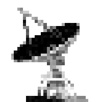
  <strong>VotV Model Manager</strong>
</h2>

An app for managing your custom **3D printer models** in [Voices of the Void](https://mrdrnose.itch.io/votv).

Browse your models, check them in a 3D viewer, and drag any `.glb` onto the window to turn it into a model the game can print. Portable GUI.

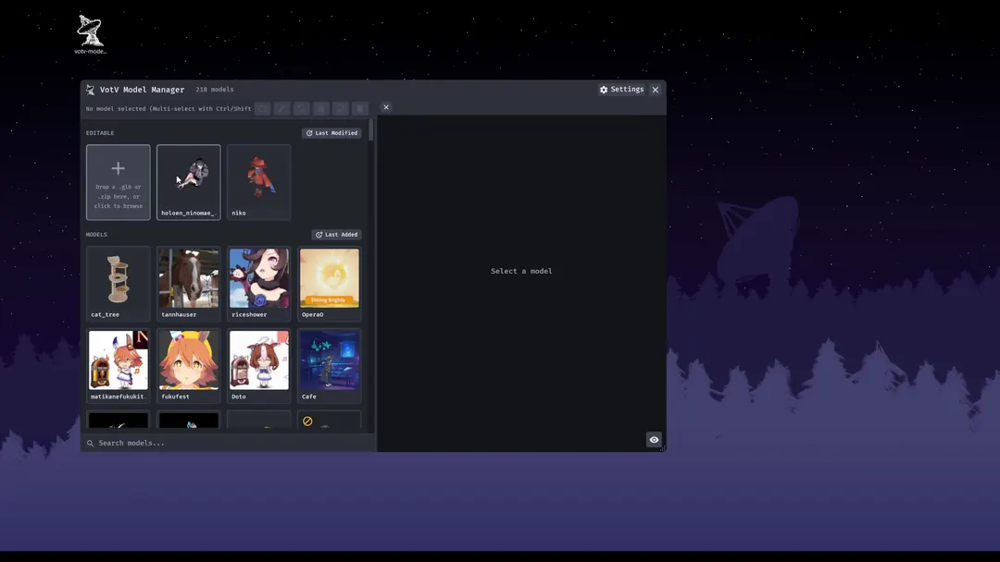

## Contents

- [Download](#download)
- [Getting started](#getting-started)
- [Your library](#your-library)
- [The 3D preview](#the-3d-preview)
- [Converting and editing](#converting-and-editing)
- [Blender](#blender)
- [The app](#the-app)
- [Good to know](#good-to-know)
- [Something went wrong?](#something-went-wrong)
- [For developers](#for-developers)

## Download

1. Open the **Releases** page of this repository (link on the right-hand side of the GitHub page).
2. Download the latest executable.
3. Launch it. No installer, it's portable.

## Getting started

1. **Start the app.** It points to your VotV printer folder automatically:
   `%LocalAppData%\VotV\Assets\meshes\printer`
   If your models are somewhere else, use the gear menu at the top and choose **Change folder...**.
2. **Click a model** to see it in the 3D preview.
3. **Add a new model:** drag a `.glb` file onto the window (or click the "Drop a .glb here" tile). The editor opens and converts it straight away.
4. **Adjust the settings** in the panel on the right. Every change regenerates the model, and the model is saved into your library immediately.

## Your library

### See your models at a glance

Every model gets an icon, drawn the way the game draws its own. The list has two sections.
- **EDITABLE**:models made with the manager, which can be opened and edited again
- **MODELS**:everything else in your printer folder). Disabled models are dimmed.

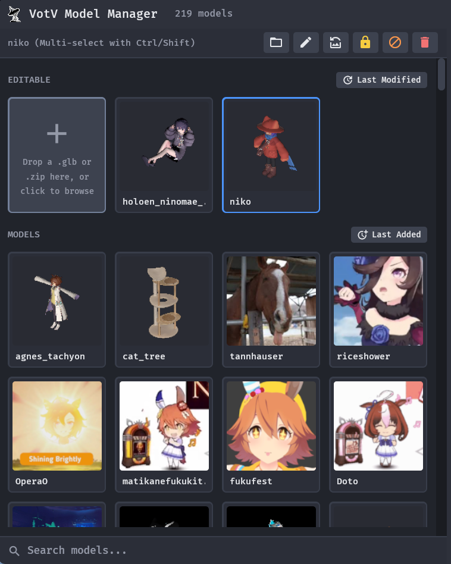

### Search

Type in the search box above the list to filter the models by name.

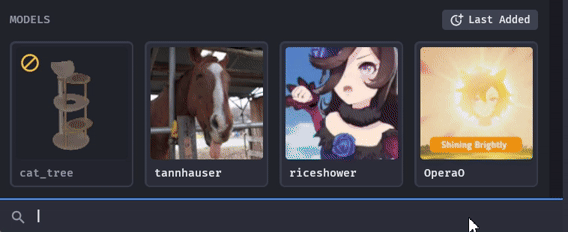

### Sort each section

Each section header has its own sort button. Click it to cycle **Last Added**, **Last Modified** and **Alphabetic**.

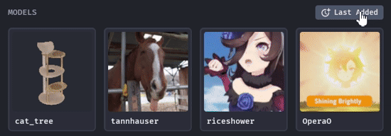

### Select one or many

Click selects a model, **Ctrl + click** adds or removes one, **Shift + click** selects everything from the last clicked model to this one. The toolbar above the list works on all selected models, and hovering a button shows what it does and which models it will touch.

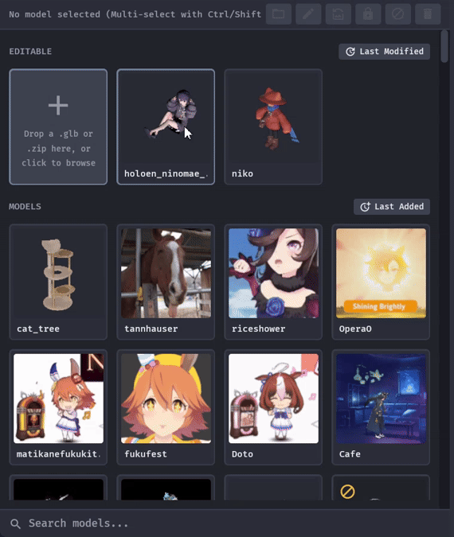

### Rename

Renames the model and every file that carries its name, including the textures, and keeps the references inside the model files in step. The name on the tile becomes a text field (Enter confirms, Escape cancels).


### Regenerate icons

Makes fresh icons for the selected models, using the game's own viewpoint.

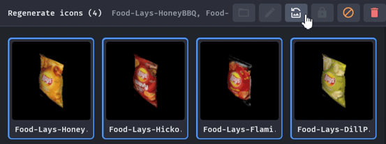

### Disable and enable

Hides a model from the game without deleting it.

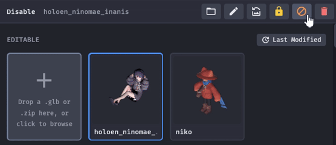

### Lock a model

Removes the saved `.glb` so a model can no longer be edited.

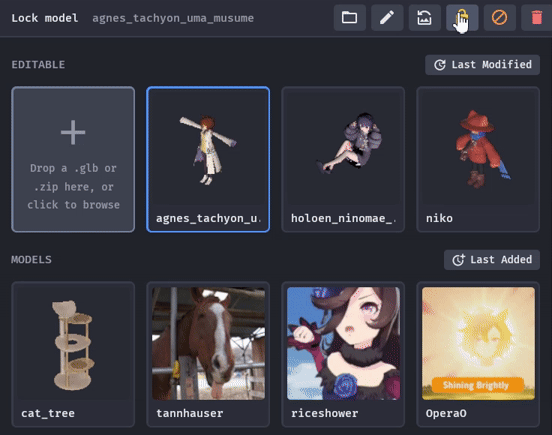

### Delete

Removes models for good. The red button asks for a second click first.

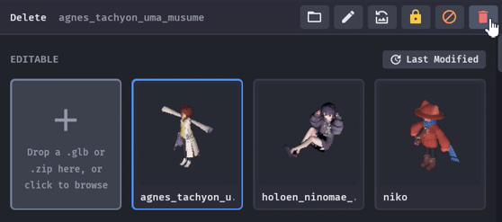

### Import ready-made models

Drop model folders or `.zip` files onto the list, or use the **Drop folders / .zip here** tile (click for a folder picker, Shift + click for a `.zip` picker). They are copied into your printer folder. Nothing is ever overwritten: a name that already exists becomes `name_2`, `name_3` and so on.

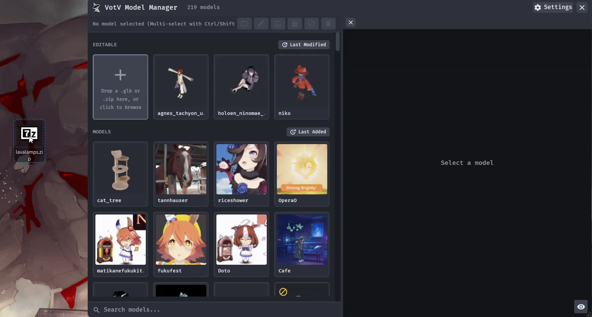

### Export a model to share

The **Export** button above the preview saves a model as a `.zip` that you can share safely: it does not contain the editable `.glb`, so others cannot use it to edit your model.

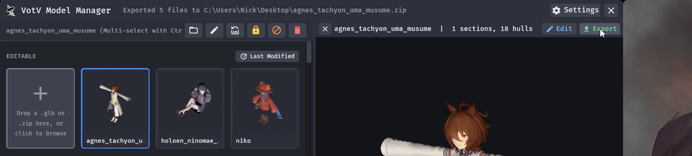

## The 3D preview

### Look at it from every side

Rotate with the left mouse button, move the view with the right one, zoom with the wheel. **Reset camera** puts the view back.

| Action | How |
|---|---|
| Rotate | Left mouse button, drag |
| Move the view | Right mouse button, drag |
| Zoom | Mouse wheel |

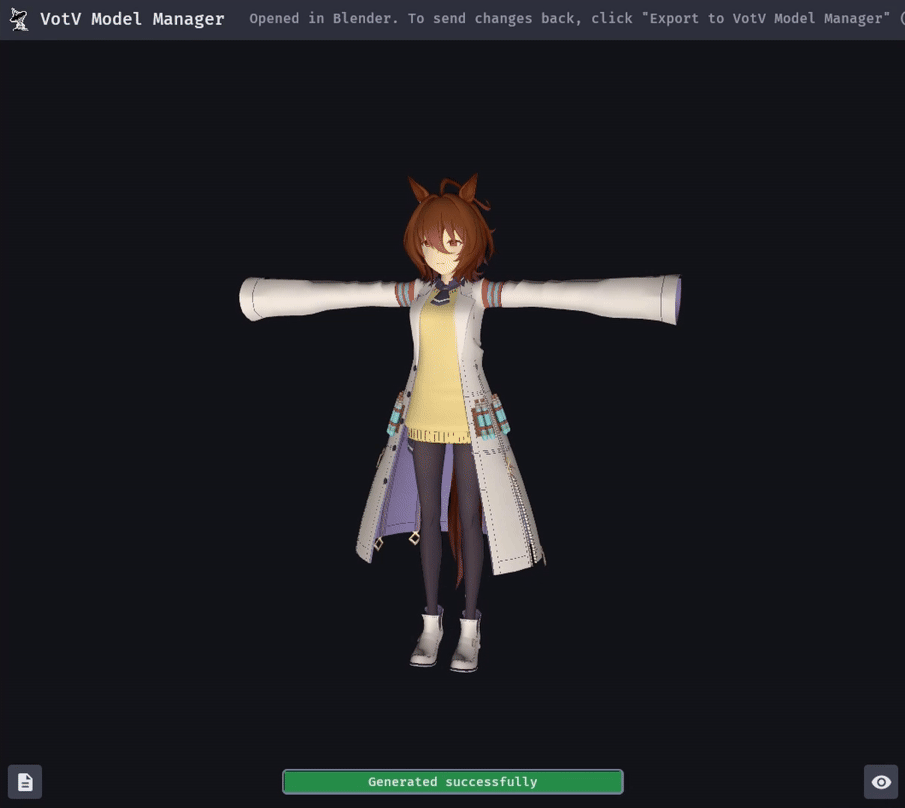

### View options

The eye button at the bottom right of the preview opens the view options. Most have a key, shown in brackets, that toggles them.

### See it like the game sees it

**Game renderer look (L)** shows the model with the game's lighting and shading, as in its icon. **Game renderer view (G)** uses the game's icon camera. Switch them off for a plain studio view. Both the preview and the generated icons get a soft overall brightness (a third of every surface's own colour), so parts the light does not reach are dark rather than black.

### Debug views

**View (C)** cycles between the textured model, the **section colours** (one colour per material section) and a **UV checker** pattern, to find stretched textures and mixed-up parts.

### Anti-aliasing

**Anti-aliasing (M)** smooths the jagged edges of the preview. It is on by default and only changes the preview, never the icons.

### Static light

By default the preview lights turn with the camera. **Static light (S)** keeps them where they are, so you can see how the light falls while you turn the model.

### When the model looks wrong

A few switches change how the preview treats the model, which helps when something looks wrong: **Flip UV V (U)**, **Flip winding (F)**, **Two-sided (B)**, **Z-up (Z)**, **Alpha (A)** (cycles through the transparency modes), **Tangents (T)** (the game's tangents or generated ones) and **Drop duplicate faces (D)**.

### Collision hulls

**Show hulls (H)** draws the collision shapes the game will use around the model. Opening the **COLLISION** section of the properties turns it on for you (an eye icon on the section header says so; click the icon to switch it off).

### Will it fit the printer?

**Printer limits (P)**, or just opening the **MODEL** section, draws the large (200 x 200 x 300 cm) and the desktop (45 x 45 x 60 cm) printer volume around the model: blue when it fits, red when it does not, with a short report at the top left. A model that is too big for every printer gets a red warning even with the volumes off.

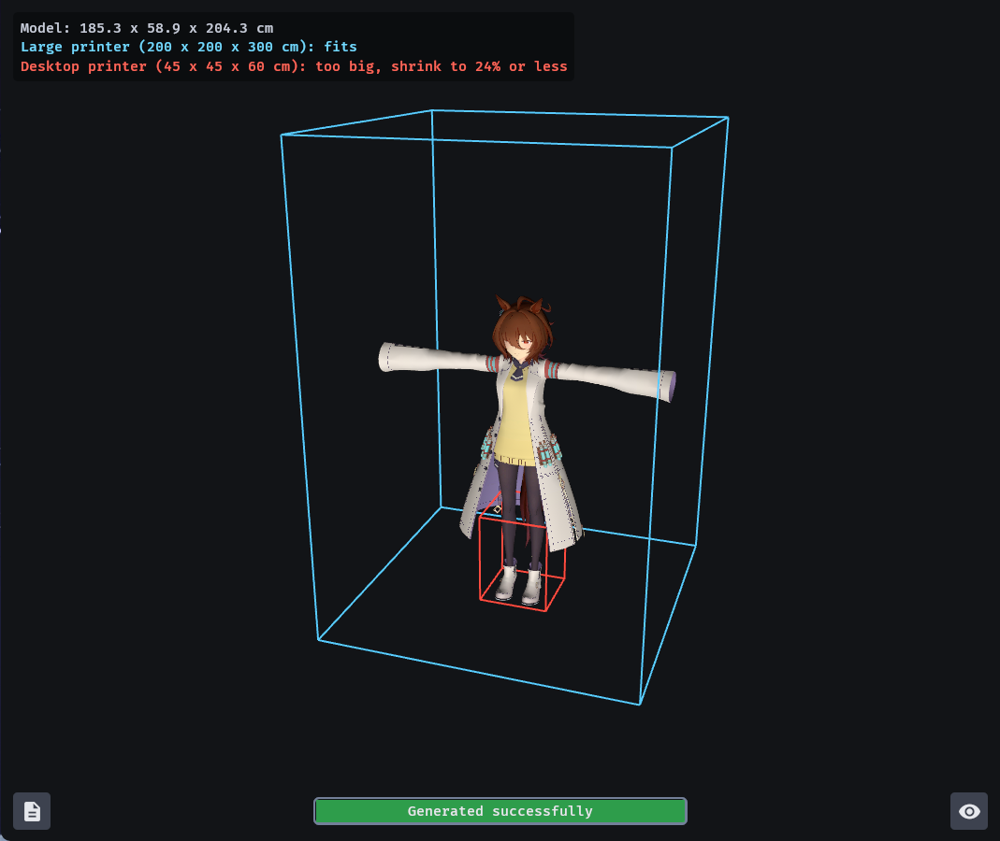

### See where the lamp is

For lamp models, **Lamp position (I)** or the **LIGHT** section draws a marker in the lamp's colour at the lamp's position, with a thin line from the model's origin. It follows the Offset sliders at once and shows through the model.

## Converting and editing

### Drop a .glb to make a printer model

Drag a `.glb` onto the window (or click the **Drop a .glb here** tile). The editor opens and converts it straight away. The manager builds the model, textures and collision the game needs and saves everything into your printer folder.

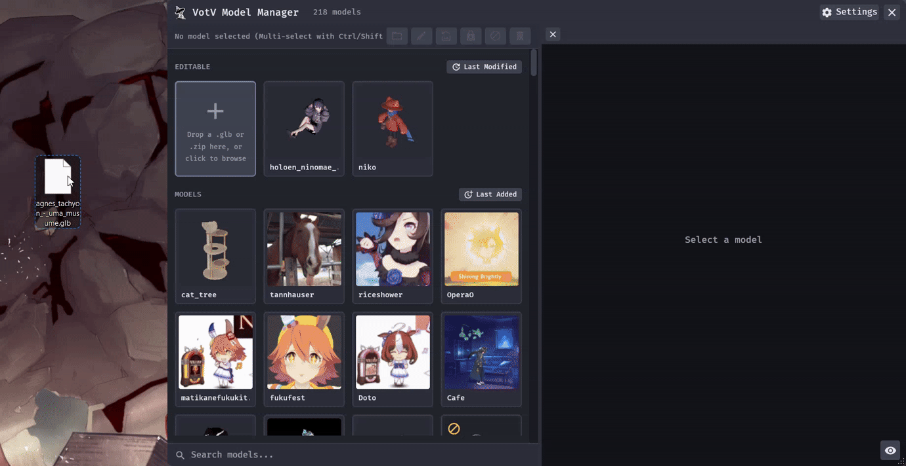

### The editor

The 3D preview on the left and the **properties** panel on the right: icon, name, an info box and the collapsible sections of settings.

### Every change shows up right away

Change any setting and the model is rebuilt; the preview updates as you go. The result is saved into your library on every change, so there is no save button to forget.

### Sliders, fields and dropdowns

Sliders can be dragged, clicked, or moved with the keyboard (arrows, PageUp / PageDown, Home / End). Click a number to type an exact value. Options that only matter when another one is on are dimmed until you switch that one on. Only one section is open at a time.

### Reset any setting

A setting that differs from its default shows a small circular-arrow button at the end of its row. One click puts the default back.

### MODEL

**Scale**, **Apply skeleton** and **Drop transparent parts**.

### TEXTURES

Texture size limits (**Max tile size**, **Max atlas size**), **Apply base colour factor**, **Flip normal green**, **Bake emissive map** and **Emissive strength**.

### COLLISION

Generate collision, ignore `UCX_` shapes, quality, VHACD resolution, maximum hulls, fallback box size and offsets, with **Show collision (debug)** to see the result.

### DURABILITY

**Indestructible**, **Health** (0 = automatic), **Impact resistance** and **Damage resistance**.

### MATERIAL

The **Physical material** of the model.

### LIGHT

Turn a model into a **Lamp** and set its intensity, radius, shadows, whether the player can switch it, its colour and its position offsets.

### TEXTURE FILTERS

Pick how the game filters each texture (**Diffuse**, **PBR**, **Normal**, **Emissive**): Nearest, Bilinear, Trilinear or Default.

### Info box

The box under the model name lists what will be in the game for the current settings: material, durability, lamp values and texture filters. It changes as you edit.

### Rename in the editor

The pencil button next to the model name starts the rename: the name becomes a text field with all its text selected. A name that does not fit scrolls to its end while the pointer is over it and glides back when it leaves.

### Icon of the model

The icon box shows the model's icon. **Capture as icon** renders a new one. To use your own picture, drop a `.png` onto the editor.

### Replace the model

Drop another `.glb` while you are editing to run the same settings on a different model.

### Posing a character

The converter only sees the pose that is saved in the exported file. It ignores animations and shape keys.

1. Pose your character in **Pose Mode**.
2. Select the mesh and choose **Object > Apply > Visual Geometry to Mesh**.
3. Delete the armature.

### Logs

The logs button at the bottom left of the preview shows what the converter did: the input, any failure, every message of the last run and which stages were reused.

### Edit later

Select a model from the EDITABLE section and click **Edit** above the preview: it reopens with all the settings it was made with.

## Blender

### Open in Blender

In the editor, the blue and orange **Open in Blender** button opens the model in a clean Blender scene. It appears only when Blender is found.

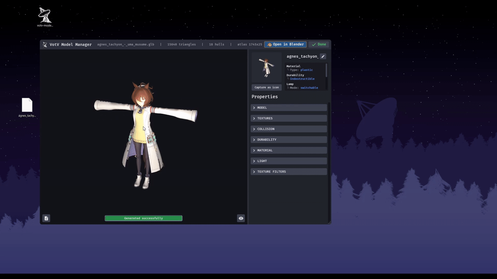

### Send changes back

The manager adds an **Export to VotV Model Manager** button inside Blender (3D view header and File menu). Click it and the model is written back; the manager notices the change by itself and regenerates the model.

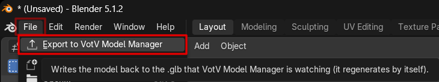
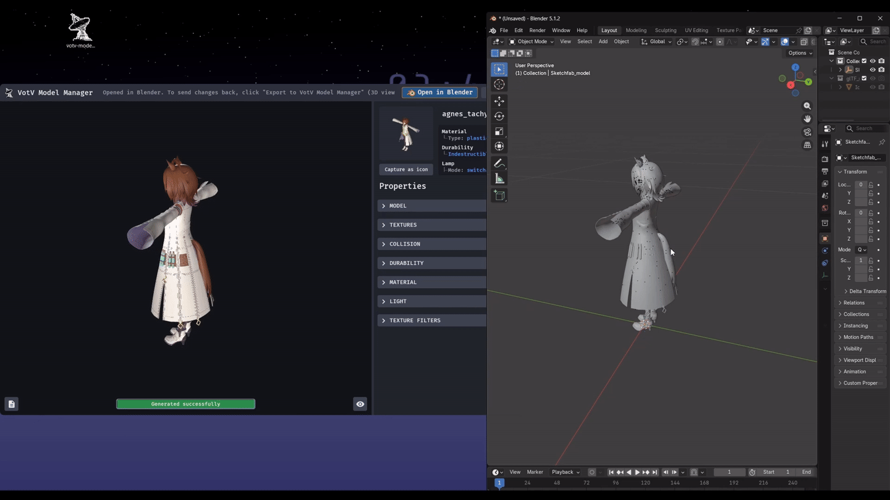

### Blender path

The manager looks for Blender in the usual places. If yours lives somewhere else, pick it under the gear menu, **Blender path...**.

## The app

### Settings menu

The gear menu has **Change folder...** (choose a different printer folder), **Refresh** (rescan the folder) and **Blender path...**.

### When something is wrong

A model that cannot be loaded shows a `!` on its tile. Run the app from a terminal with `--diagnose "C:\path\to\ModelFolder"` to get a report to include when you ask for help.

### Build number

The small gray number next to the app name is the build number. Mention it when you report a problem.

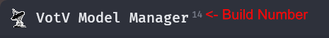

## Good to know

- Only **.glb** files can be converted. Other file types are ignored.
- Dropping a model **folder** or a model **.zip** copies it into your library instead of converting it.
- The first time the 3D view opens there may be a short pause while it gets ready.
- Names with non-English letters may show up as boxes in the list.
- **Open in Blender** appears only when Blender is found. If it is not, set it under the gear menu, **Blender path...**.
- The printer limits come from the game's own size check, as found by reverse engineering (see `docs/printer-size-check.md`). Which model axis the game treats as "up" is not confirmed: if the report disagrees with the game, toggle **Z-up (Z)** and compare with the "SMALL BOX" values the game prints when you select the model.
- Settings are stored in `%LocalAppData%\VotV Model Manager`.

## Something went wrong?

- **A model shows a `!`** and will not load: open a terminal and run
  `votv-model-manager.exe --diagnose "C:\path\to\ModelFolder"`
  then include the report when you ask for help.
- **The list is empty:** the message in the list names the folder being used; pick another one under **Settings > Change folder...**. A model is a sub-folder that contains an `.obj` file.
- **Reporting a problem:** please mention the small gray number next to the app name in the title bar (for example `42`). It is the build number, the same as the release name `build.42` you downloaded from.

## For developers

Built with Rust and [Bevy](https://bevyengine.org/). To build it yourself:

```
cargo run --release
```

or for debugging:
```
cargo run --features bevy/dynamic_linking
```

The build number in the title bar is the GitHub Actions run number (`GITHUB_RUN_NUMBER`, passed in by `build.rs`); a local build has none, so nothing is shown.

Icons come from Google's Material Icons font plus a tiny Material Symbols subset (both Apache-2.0); see `docs/icon-fonts.md`.

README pictures live in `docs/media/` (see `docs/media/SHOT-LIST.md`).

More technical notes are in `docs/` and `converter/README.md`.

## Disclosure

This project is being vibe coded with Claude Sonnet 5.5 (Free Tier).

This is high quality slop. The app UX and Design were not generated by AI.

Not a single penny was given to the evil AI corporations in the process of building this.


## Not affiliated

This is a fan-made tool. It is not made by or affiliated with the developer of Voices of the Void.
